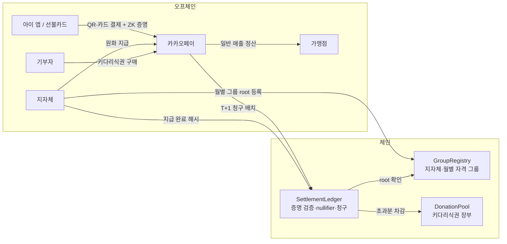
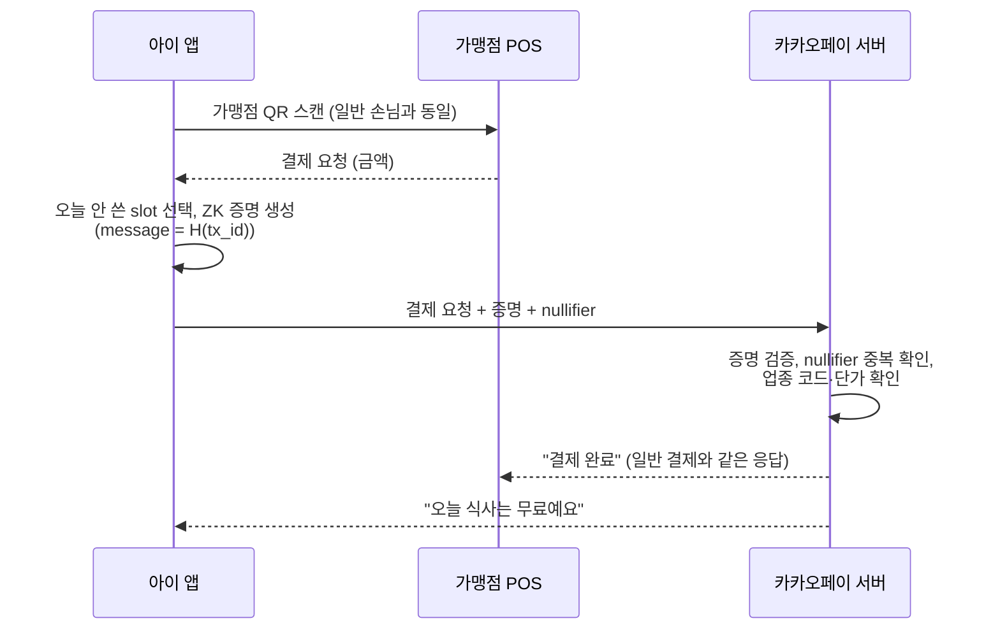

# 아동급식카드 통합결제 지원사업 설계안

> 현행 아동급식카드를 카카오페이 결제 흐름 안으로 옮기고, 정산은 블록체인에서 검증한다.
> 시민 기부 파트인 키다리식권은 미라이 티켓(나라현 겐키 카레)에서 착안했다.

---

## 0. 한 줄 요약

아이는 일반 손님과 똑같이 카카오페이 QR(또는 평범한 선불카드)로 결제하고, 무료라는 표시는 아이 화면에만 뜬다. 가맹점은 일반 카카오페이 매출로만 받는다. 카카오페이는 다음 날 영지식 증명 묶음을 체인에 올려 지자체 예산에서 돌려받는다.

---

## 1. 문제와 목표

| 현행 아동급식카드의 문제 | 이 설계의 목표 |
|---|---|
| 카드 디자인과 결제 과정이 달라서 계산대에서 티가 남 | 결제 행위가 일반 손님과 완전히 같음 |
| 쓸 수 있는 가맹점이 적음 | 카카오페이 QR을 받는 가게면 어디든 (업종 제한만 적용) |
| 지자체·카드사가 아이별 사용 내역을 다 봄 | 지자체는 집계만 보고, 아이별 동선은 모름 |
| 예산이 실제로 아이 식사로 쓰였는지 외부에서 검증할 방법이 없음 | 모든 청구 건이 증명과 함께 체인에 남아 누구나 검증 가능 |

목표가 **아닌 것**: 운영사(카카오페이)한테까지 숨기는 것. 이건 현행 카드사 수준의 신뢰를 그대로 둔다(9장 참고).

---

## 2. 설계 원칙

1. **낙인 제거는 UX가, 검증은 체인이 맡는다.** 블록체인이 결제 화면을 바꾸지는 않는다.
2. **돈은 원화로 기존 망에서 움직이고, 체인은 검증 원장으로만 쓴다.** 스테이블코인 규제를 피하고 기존 정산을 그대로 쓴다.
3. **아이 쪽 인프라를 0으로 만든다.** 아이가 지갑 주소, 시드, 가스비를 알 필요가 없다.
4. **폐기 대신 만료.** 자격은 매달 새로 발급해서 폐기(revocation) 인프라를 없앤다.

---

## 3. 참여자

| 참여자 | 역할 |
|---|---|
| 아이 | 카카오페이 앱 QR 또는 선불카드로 결제 |
| 보호자 | 앱 가입·카드 발급 동의, 필요하면 잔액 충전 |
| 지자체 | 지원 대상 확정, 매달 자격 그룹 발급, 예산 풀 운영, 정산 지급 |
| 카카오페이 | 결제 처리, 결제 시점 1차 검증, 가맹점 선지급, 체인 청구 |
| 가맹점 | 평소처럼 카카오페이 결제를 받음. 급식 여부를 모름 |
| 기부자 | 키다리식권을 구매해 기부 풀에 적립 |
| 감사기관·시민 | 체인 데이터로 청구·지급을 검증 |

---

## 4. 전체 구조



핵심은 **가맹점이 체인과 무관하다**는 점이다. 가맹점은 카카오페이한테 평소처럼 정산받고, 체인 위의 정산은 카카오페이와 지자체(그리고 기부 풀) 사이에서만 일어난다.

---

## 5. 아이 결제 흐름

### 5.1 폰이 있는 아이: 카카오페이 QR



- 금액이 1끼 단가를 넘으면 **분할 결제**: 단가까지는 예산, 초과분은 아이 잔액에서 결제. 아이 화면에만 "무료 + 초과 1,500원"처럼 나온다.
- 잔액도 없으면 일반 선불 잔액 부족과 **같은 거절 메시지**를 보낸다. 급식 거절인지 잔액 거절인지 POS에서 구분되지 않는다.

### 5.2 폰이 없는 아이: 카카오페이 선불카드

- 디자인이 일반 카카오페이 카드와 똑같은 선불카드를 발급한다. 급식 전용 표시는 없다.
- 카드 결제는 카드망으로 카카오페이에 들어오고, 카카오페이가 그 카드에 묶인 아이 비밀값(HSM 보관)으로 **서버에서 대신 증명을 만든다.**
- 그래서 이 경로에서는 카카오페이가 "이 카드가 지원 대상"이라는 걸 안다. 현행 급식카드의 카드사와 같은 수준이다. 가맹점·옆 손님·지자체·체인은 여전히 모른다.

### 5.3 카드에서 앱으로 넘어가기, 자격 종료

| 시점 | 처리 |
|---|---|
| 카카오페이 앱을 쓸 수 있는 나이가 됨 | 보호자 동의를 받아 앱에 가입하고 기존 선불카드를 계정에 등록. 잔액은 그대로 이어짐 |
| 앱 등록 직후 | 앱 기기에서 새 비밀값 생성, 다음 달 자격 그룹에 새 commitment 등록, 서버에 있던 카드용 비밀값은 폐기 |
| 이후 | QR과 카드 둘 다 사용 가능 (카드 결제는 서버 증명 경로) |
| 지원 자격 종료 (성인 등) | 다음 달 그룹에서 빠짐. 앱과 카드는 **일반 결제수단으로 그대로 남는다.** 바꾸거나 반납할 게 없어서 지원받았던 흔적도 남지 않음 |

### 5.4 화면 규칙

| 화면 | 표시 |
|---|---|
| 가맹점 POS·영수증 | "카카오페이 결제 완료", 금액. 급식·지원 관련 문구 없음 |
| 가맹점 정산 내역 | 일반 카카오페이 매출과 구분 없음 |
| 아이 앱 | "오늘 식사는 무료예요" + 오늘 남은 끼니 수. 초과분이 있으면 초과 금액 |
| 알림 | 잠금화면 알림 문구도 일반 결제와 같게 ("결제 완료"). 무료 표시는 앱을 열었을 때만 |

---

## 6. 자격 증명 (영지식)

### 6.1 방식: 월별 그룹 멤버십 + nullifier

MVP는 Semaphore(v4) 구조를 그대로 쓴다. 회로를 직접 짤 필요가 없다.

- **등록**: 아이 기기(또는 카드 경로에서는 HSM)가 비밀값 `sk`를 만들고 `commitment = Poseidon(sk)`만 지자체에 낸다.
- **그룹 발급**: 지자체가 매달 지원 대상의 commitment로 머클 트리를 만들고 root를 체인 `GroupRegistry`에 등록한다. `(지자체, 년월) → root`.
- **증명**: 결제할 때마다 아래를 증명한다.

```
공개 입력: root, scope, nullifier, message
비공개 입력: sk, 머클 경로

조건:
  1) Poseidon(sk)가 root 트리에 들어 있다
  2) nullifier = Poseidon(scope, sk)
  3) message = H(tx_id)   // 이 거래에 묶여서 재사용 불가
```

### 6.2 하루 끼니 한도를 회로 수정 없이 거는 법

`scope = H(날짜, slot)`으로 둔다. 하루 3끼라면 slot은 0, 1, 2.

- 같은 날 같은 slot을 두 번 쓰면 nullifier가 같아서 거절된다.
- 앱이 slot 99 같은 걸 넣어 한도를 우회하지 못하도록, **컨트랙트가 허용 scope 목록을 직접 계산한다.** 지자체별 하루 한도 N에 대해 `{H(날짜,0) … H(날짜,N-1)}`에 속한 scope만 받는다.
- 날짜가 바뀌면 scope가 바뀌어서, 같은 아이가 낸 어제 nullifier와 오늘 nullifier는 서로 연결되지 않는다.

### 6.3 매달 갱신하는 이유

- 자격을 잃은 아이는 다음 달 트리에서 빠지면 끝이다. 폐기 목록이나 accumulator가 필요 없다.
- 그룹이 매달 새로 만들어져서 장기 추적도 어려워진다.
- 실제 운영에서는 모바일 신분증·DID 체계와 맞추려고 BBS+ VC로 바꿀 수 있다. MVP에서는 오버엔지니어링이다.

---

## 7. 정산 체인

### 7.1 체인에 올라가는 것과 안 올라가는 것

| 올라감 (공개) | 안 올라감 |
|---|---|
| 지자체·월별 그룹 root, 그룹 크기 | 아이 이름, commitment와 실명의 연결 |
| 거래별 증명, nullifier, 날짜(일 단위), 지원 금액 | 결제 시각(분·초), 카카오페이 계정 |
| 업종 코드, 지역(구 단위) | 가맹점 이름·ID (감사기관에만 별도 제공) |
| 지자체 → 카카오페이 지급 완료 해시 | 실제 원화 이체 내역 |
| 기부 풀 적립·차감 장부 | 기부자 실명 (영수증 발급용으로 카카오페이만 보관) |

### 7.2 컨트랙트

| 컨트랙트 | 하는 일 |
|---|---|
| `GroupRegistry` | `(지자체, 년월) → root` 등록. 지자체 키만 쓰기 가능 |
| `SettlementLedger` | 청구 배치 받기 → 건별 증명 검증, scope 허용 여부, nullifier 미사용, 금액 ≤ 단가, 업종 허용 확인 → 통과분 합계를 지자체 앞 청구로 기록 |
| `DonationPool` | 키다리식권 적립. 단가 초과분이나 추가 끼니를 이 풀에서 차감 |
| (선택) `Payout` | 지자체가 원화 지급 후 이체 증빙 해시 기록. 청구-지급 대사용 |

### 7.3 정산 순서

1. **결제 시점(실시간)**: 카카오페이가 오프체인에서 증명을 검증하고 승인. 가맹점에는 평소 일정대로 정산.
2. **T+1**: 카카오페이가 전날 급식 거래를 묶어 `SettlementLedger`에 제출.
3. **체인 검증**: 통과한 건만 청구액에 들어간다. 탈락한 건은 카카오페이 손실로 처리한다. 선지급 리스크를 운영사가 지니까 결제 시점 검증을 제대로 할 유인이 생긴다.
4. **지자체 지급**: 통과 합계만큼 원화를 카카오페이에 이체하고 증빙 해시를 기록.
5. **공개 대시보드**: 지역·업종·일 단위 끼니 수와 금액. 해당 칸의 건수가 일정 수 미만이면 공개를 늦추거나 상위 지역으로 합친다(작은 동네에서 역추적되는 것 방지).

거래마다 Groth16 검증을 하면 EVM 기준 건당 수십만 gas 수준이라, 메인넷이 아니라 L2나 허가형 체인을 전제로 한다. 물량이 커지면 배치 증명 집계(aggregation)로 바꾼다.

### 7.4 체인 선택지

| 선택지 | 장점 | 단점 |
|---|---|---|
| 허가형 EVM (지자체·카카오페이·감사기관·시민단체가 검증 노드) | 공공사업으로 가장 현실적, 비용 예측 가능 | "누구나 검증"이 노드 참여자로 한정됨 |
| 공개 L2 | 누구나 검증 가능, 신뢰 최소화 | 공개 범위를 더 엄격하게 잘라야 함 |
| 프라이버시 체인 (예: Midnight) | 숨김 처리를 체인이 기본 지원 | 생태계·도구 성숙도, 공공기관 채택 장벽 |

MVP는 EVM 테스트넷에서 Semaphore 컨트랙트를 그대로 쓰고, 실서비스 논의는 허가형 EVM부터 시작하는 게 무난하다.

---

## 8. 키다리식권 기부 풀 (미라이 티켓)

- 기부자는 카카오페이에서 **키다리식권**을 산다. 1장 = 1끼 단가.
- 기본은 공동 풀이라 어느 가게에서든 쓰인다. 원하는 기부자만 지역이나 가게를 지정할 수 있다. 가게만 지정한 식권이 몰리면 아이가 그 가게로만 가야 하고, 작은 가게에서는 누가 먹었는지 짐작하기 쉬워지기 때문에 지정은 선택으로 둔다.
- `DonationPool`에 장 수가 적립되고, 쓰이면 차감된다. 기부자 화면에는 "내 식권 10장 중 7장 사용됨 (서울 ○○구, 음식점)"처럼 **누가 먹었는지 없이** 사용 여부만 보인다.
- 쓰이는 곳:
  1. 지자체 단가를 넘는 초과분 보전
  2. 방학처럼 끼니 수가 늘어나는 기간의 추가 끼니
- 기부금 영수증은 카카오페이가 오프체인에서 발급한다. 체인에는 기부자 실명이 올라가지 않는다.
- 원래 미라이 티켓은 아무 아이나 떼 갈 수 있지만, 여기서는 지자체 자격 그룹 안에서만 쓴다. 남용 방지를 위한 의도적인 차이다.

---

## 9. 누가 무엇을 아는가

| | 이 사람이 지원 대상인가 | 개별 식사 장소·날짜 | 집계 |
|---|---|---|---|
| 옆 손님 | 모름 | 모름 | — |
| 가맹점 | 모름 (일반 카카오페이 매출) | — | — |
| 카카오페이 | **앎** (계정·카드 단위) | **앎** | 앎 |
| 지자체 | 앎 (원래 대상자를 선정함) | **모름** ← 개선점 | 앎 |
| 공개 체인·시민 | 모름 | 모름 (일·구·업종 단위만) | 앎 |
| 기부자 | 모름 | 모름 | 자기 식권 사용 여부 |

**정직하게 말하면**, 카카오페이를 상대로 한 프라이버시는 지키지 못한다. 결제가 아이 계정에서 일어나는 이상 운영사는 안다. 이건 현행 카드사와 같은 수준이고, 계약으로 데이터 분리 보관·목적 외 사용 금지를 거는 수밖에 없다. 이 설계가 줄이는 건 **계산대에서의 낙인**과 **지자체·외부로 새는 아이별 동선**이다.

---

## 10. 남용 방지

| 위협 | 대응 |
|---|---|
| 하루 끼니 초과 사용 | scope 허용 목록 + nullifier (6.2) |
| 증명 재사용·가로채기 | message = H(tx_id)로 거래에 묶음 |
| 폰·카드를 남에게 빌려줌 | 현행과 같은 리스크. 하루 한도로 피해 상한을 둠 |
| 가맹점과 짜고 현금화 | 업종 제한, 가맹점별 급식 결제 비율 이상치 탐지 (가맹점 단위 데이터는 감사기관만) |
| 가맹점 허위 청구 | 가맹점은 청구 주체가 아님. 아이 증명 없이는 청구 자체가 성립하지 않음 |
| 카카오페이 허위·과다 청구 | 체인 검증을 통과한 건만 지급 |
| 지자체가 가짜 멤버를 그룹에 넣음 | 월별 그룹 크기 공개 → 대상자 수 통계와 대조 감사 |

---

## 11. 확인해야 할 것

아래는 설계 전제라서 실제로 확인이 필요하다.

- [ ] 카카오페이 미성년자 가입 가능 연령, 보호자 동의 절차
- [ ] 카카오페이 선불카드를 아동 명의로 발급할 수 있는지, 발급 가능 연령
- [ ] 지자체별 급식카드 사업자 선정 구조 (카드사·운영사 계약)와 들어갈 경로
- [ ] 전자금융거래법상 선불전자지급수단 요건
- [ ] 개인정보보호법상 만 14세 미만 아동 정보 처리, 법정대리인 동의
- [ ] 기부금품법 모집 등록 요건, 기부금 영수증 발급 주체
- [ ] 원화 스테이블코인 제도화 시점 (온체인 풀로 확장할 때만 해당)
- [ ] 모바일에서 Semaphore 증명 생성 시간 (결제 대기 목표 2초 안쪽)

---

## 12. MVP 범위 (시연용)

| 구성 | 내용 |
|---|---|
| 증명 | Semaphore v4 그대로, scope = H(날짜, slot), message = H(tx_id) |
| 컨트랙트 | `GroupRegistry`, `SettlementLedger`, `DonationPool` (원화는 mock ERC-20) |
| 결제 앱 (웹) | QR 스캔 → 증명 생성 → 일반 손님 모드 / 아이 모드 화면 |
| POS 화면 | 두 모드 모두 똑같은 "결제 완료" |
| 정산 배치 | 하루치 거래를 모아 체인 제출하는 스크립트 |
| 대시보드 | 지자체(집계·청구·지급), 기부자(내 식권 사용 여부), 공개(지역·업종 집계) |

**데모 시나리오**

1. 일반 손님과 아이가 같은 가게 QR을 차례로 찍는다.
2. POS 화면은 둘 다 똑같이 "결제 완료".
3. 아이 화면에만 "오늘 식사는 무료예요".
4. 아이가 같은 날 한도를 넘겨 결제하면 초과분만 잔액에서 결제됨.
5. 정산 배치를 돌리면 체인에서 검증되고, 대시보드에 집계와 기부 식권 사용이 반영됨.
